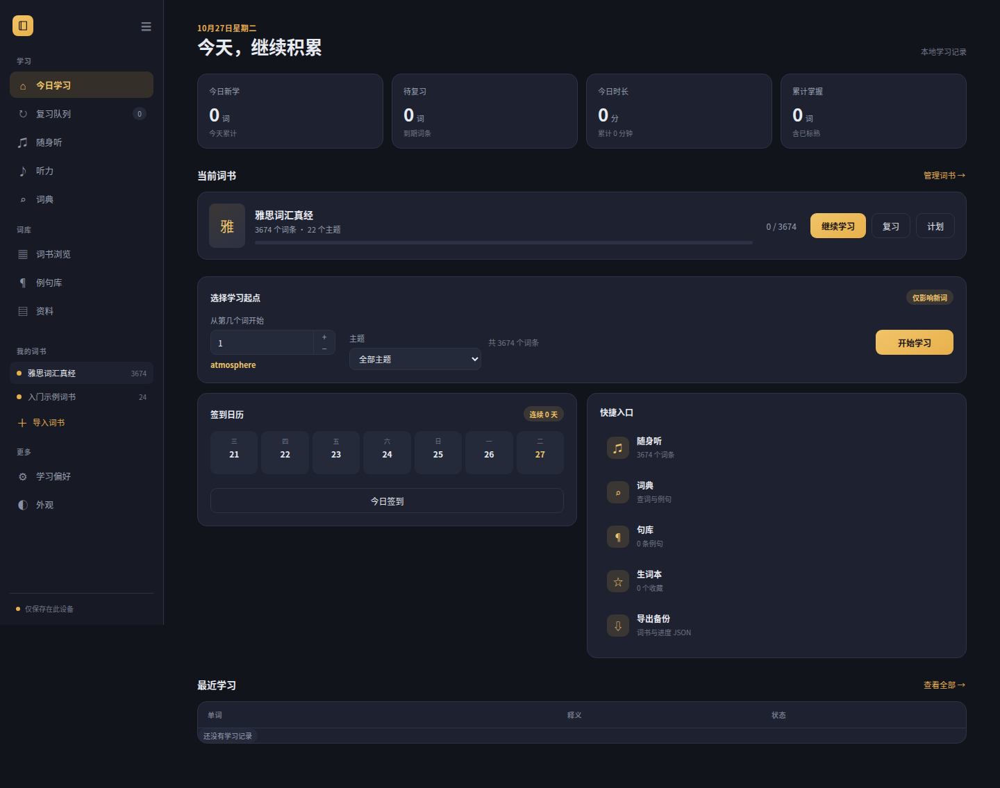
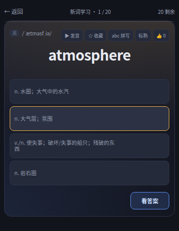

# VocabLearn

VocabLearn 是一个本地优先的 IELTS 英语词汇学习应用，面向桌面和窄屏窗口使用。应用将词书、学习记录和个性化设置保存在当前设备中，基础学习流程不依赖网络。

## 功能

- 按词书和主题学习新词
- 间隔复习和复习队列
- 中英文释义、音标、发音和例句展示
- 选择题、拼写练习和听音选义
- 例句收藏、单词收藏和学习笔记
- 词典搜索、词书浏览和本地词书导入
- 英式与美式音标切换
- 明亮、深邃和夜间主题
- 字体大小和字体风格设置
- 学习进度导出、恢复和本地备份
- 桌面窗口与浏览器窗口均可使用

## 界面截图

### 今日学习与学习卡片

主界面集中显示今日进度、学习入口和当前词书状态。进入学习后，学习卡片提供单词、音标、释义、发音、收藏、拼写和答题操作；答题后可以查看例句、词组搭配、构词信息和个人笔记。



### 词书浏览与词典

词书浏览用于按主题查看词条、搜索单词和查看学习状态。词典页面支持按单词、释义或例句搜索，并提供音标、发音、中文释义和例句详情。

### 复习队列与听力

复习队列显示需要复习的词条，并可直接进入单词复习。随身听按词表播放单词音频，听力页面支持播放、填写答案、查看结果和切换题目。

### 小窗模式

应用适配 `350×450` 的窄窗口。侧栏会压缩为横向图标导航，学习卡片和选择题选项保持在窗口宽度内；当字体增大或某个选项需要两行时，四个选项会统一调整为相同高度。



## 运行

项目是一个无需构建步骤的静态 Web 应用。可以使用任意静态文件服务器启动：

```bash
./VocabLearn --start
```

默认地址为 `http://127.0.0.1:4173`。停止服务：

```bash
./VocabLearn --stop
```

也可以直接使用其他静态服务器打开项目根目录。浏览器需要通过 HTTP 服务加载本地词库模块和音频资源。

## 目录结构

- `index.html`：应用页面结构和入口
- `app.js`：学习流程、词库加载、记录、备份和交互逻辑
- `styles.css`：主题、响应式布局和组件样式
- `ielts/src/pages/vocabulary/`：IELTS 词汇数据
- `ielts/phonetics.json`：音标数据
- `ielts/listening/`：听力数据和音频资源
- `ielts/reading/`：阅读词汇数据
- `ielts/writing/`：写作句型数据
- `desktop-rs/`：桌面窗口和本地状态服务

## 数据保存

浏览器版本使用 `localStorage` 和 IndexedDB 保存词书、学习进度、收藏、笔记和设置。桌面版本还会将学习状态同步到本地 SQLite 数据库。应用提供导出备份功能，用于迁移设备或恢复数据。

## 导入词书

支持 UTF-8 编码的 CSV、TSV 和 JSON 文件。常用字段包括：

```text
word,meaning,example,translation,phonetic,audio
```

JSON 可以是词条数组，也可以是包含 `name` 和 `words` 的对象。词条还可以提供 `exampleTranslation`、`syllables`、`category` 等可选字段。

## 开发检查

修改 JavaScript 后可以运行：

```bash
node --check app.js
git diff --check
```

桌面端构建需要 Rust 工具链和 Cargo。
